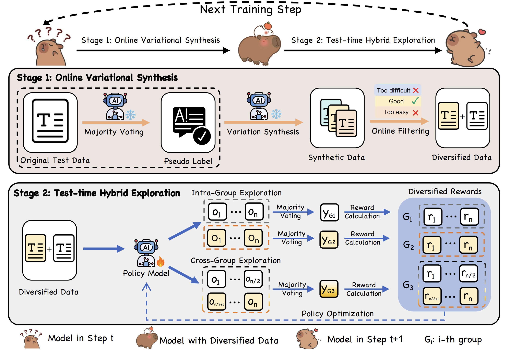

# TTVS: Test-Time Variational Synthesis

Official implementation of **TTVS: Boosting Self-Exploring Reinforcement Learning via Test-time Variational Synthesis**, published in Findings of ACL 2026.

TTVS adapts a large reasoning model directly on unlabeled test queries. It creates its own supervision through majority voting, synthesizes candidate query variants intended to preserve the original semantics, and combines query-level and cluster-level exploration during reinforcement learning.

- Paper: [ACL Anthology](https://aclanthology.org/2026.findings-acl.1634/)
- Framework: [verl](https://github.com/volcengine/verl)
- Included tasks: MATH-500, AIME 2024, AMC 2023, and GPQA
- Model families evaluated in the paper: Qwen3, Qwen2.5, and LLaMA

## Method

TTVS contains two stages.

### 1. Online Variational Synthesis

For each original unlabeled query `q`, TTVS:

1. samples multiple reasoning responses from the current policy;
2. extracts their final answers and obtains a pseudo-label by majority vote;
3. estimates query difficulty from agreement with that pseudo-label;
4. retains queries whose agreement lies within `[tau_low, tau_high]`;
5. synthesizes candidate query variants intended to be semantically equivalent from correct reasoning trajectories;
6. filters malformed or overlength variants online.

This converts a static query into a semantic cluster:

```text
original query q
    ├── variant q'_1
    ├── variant q'_2
    └── variant q'_3
```

### 2. Test-Time Hybrid Exploration

TTVS uses two complementary policy-update groups:

- **Intra-Group Exploration (IGE):** performs majority voting and reward assignment independently for each original or synthesized query. It emphasizes accuracy on each individual formulation.
- **Cross-Group Exploration (CGE):** distributes a fixed rollout budget across the original query and its selected variants, performs one majority vote over the mixed cluster, and assigns a shared consistency reward. It encourages invariance across equivalent formulations.

```text
Unlabeled query
      │
      ▼
Pseudo-label and difficulty filtering
      │
      ▼
Online variational synthesis ──► semantic query cluster
      │                                  │
      ├──────── IGE: per-query vote ─────┤
      └──────── CGE: cluster vote ───────┘
                                         │
                                         ▼
                                  GRPO policy update
```

IGE and CGE use explicit group identities in the implementation: `query_id` identifies an IGE group, while `cluster_id` connects an original query to all of its variants for CGE.

## Installation

### Requirements

- Linux
- Python 3.10 or newer
- CUDA-compatible NVIDIA GPUs
- Eight GPUs for the paper-scale Qwen3 launchers; smaller runs also require corresponding batch, rollout, token-length, and memory adjustments
- A local Hugging Face model checkpoint
- `bc` for the Qwen3 MATH launcher

Create and activate an environment, then install the repository:

```bash
conda create -n ttvs python=3.10 -y
conda activate ttvs

pip install -e ".[vllm,math]"
```

## Data Preparation

Raw JSON files are included under [`data/`](data/). Each source example follows this structure:

```json
{
  "prompt": "problem text",
  "answer": "reference answer"
}
```

The reference answer is retained only for evaluation and diagnostic metrics. TTVS constructs the reward used for policy optimization from the model's own majority-vote pseudo-label.

The trainer expects Parquet files containing:

- `data_source`
- chat-formatted `prompt`
- `reward_model.ground_truth`
- `extra_info.index`

Convert a benchmark from the repository root. The converter resolves paths relative to `data/` and writes `train.parquet` and `test.parquet` into the selected benchmark directory:

```bash
# MATH-500 uses train_init.json as its unlabeled test-time training stream.
python data/preprocess.py --data-source MATH-TTT

python data/preprocess.py --data-source AIME-TTT
python data/preprocess.py --data-source AMC-TTT
python data/preprocess.py --data-source GPQA-TTT
```

Use `--train-file` or `--test-file` to select a different JSON file. For example:

```bash
python data/preprocess.py \
  --data-source MATH-TTT \
  --train-file train_mix_new.json
```

For MATH-500, `train_init.json` is identical to `test.json`: the same test queries form the unlabeled adaptation stream. Answers remain in the files for evaluation and diagnostics, but TTVS does not use them as the policy-optimization reward target.

The resulting files must be available as:

```text
data/<TASK>/train.parquet
data/<TASK>/test.parquet
```


### Benchmark Training

For a standalone Qwen3-4B MATH run, use the wrapper that initializes a local Ray head. The launchers contain machine-specific default paths, so override the model and output locations:

```bash
TTVS_LOAD_MODULES=0 TTVS_CONDA_ENV=ttvs \
bash scripts/train_qwen3.sh \
  actor_rollout_ref.model.path=/path/to/Qwen3-4B \
  critic.model.path=/path/to/Qwen3-4B \
  trainer.default_local_dir=/path/to/checkpoints/ttvs-math
```

To use an existing Ray cluster, set `RAY_ADDRESS` and invoke the benchmark launcher directly. Reducing the GPU count generally also requires smaller batch sizes, rollout budgets, sequence lengths, and micro-batches.

See [`Configuration`](docs/Configuration.md) for benchmark-specific launchers and the full set of TTVS overrides.

## Citation

If you use TTVS, please cite:

```bibtex
@inproceedings{bai2026ttvs,
  title={Ttvs: Boosting self-exploring reinforcement learning via test-time variational synthesis},
  author={Bai, Sikai and Li, Haoxi and Zhang, Jie and Liu, Yongjiang and Guo, Song},
  booktitle={Findings of the Association for Computational Linguistics: ACL 2026},
  pages={32651--32665},
  year={2026}
}
```

## Acknowledgements

This repository is built on [verl](https://github.com/volcengine/verl), whose distributed training, rollout, and worker infrastructure make the TTVS implementation possible.

## License

The code is released under the [Apache License 2.0](LICENSE).
